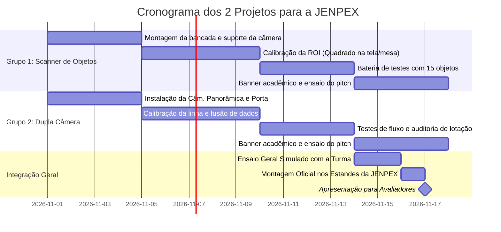

# 📅 CRONOGRAMA INTEGRADO: 2 PROJETOS DE IA PARA A JENPEX

---

### ⏱️ Organização das Fases (4 Semanas de Preparação)
Este cronograma alinha o **Grupo 1 (Scanner de Objetos)** e o **Grupo 2 (Dupla Câmera de Ocupação)** para que ambas as equipes avancem juntas e realizem ensaios conjuntos antes do evento oficial.

---

### 🗓️ Metas Semanais Compartilhadas

#### 📌 Semana 1: Estruturação dos Equipamentos e Primeiro Teste
- **Grupo 1:** Fixa a webcam apontada para a mesa e cola o quadrado de fita na bancada. Testa o executável `iniciar_projeto1_scanner.bat`.
- **Grupo 2:** Fixa a câmera panorâmica interna e a câmera da porta com a fita no chão. Testa o executável `iniciar_projeto2_cameras.bat`.

#### 📌 Semana 2: Calibração Fina dos Algoritmos de IA
- **Grupo 1:** Alinha as margens do quadrado virtual com o quadrado físico e testa a tradução e velocidade de identificação.
- **Grupo 2:** Ajusta a linha de corte virtual e verifica a estabilidade dos IDs rastreados ao cruzar a porta.

#### 📌 Semana 3: Bateria de Testes Científicos e Confecção dos Banners
- **Grupo 1:** Executa os testes formais com os 15 objetos escolares e preenche a Tabela de Acurácia.
- **Grupo 2:** Executa os testes de entrada, saída e pessoas sentadas no salão para a Tabela de Auditoria Cruzada.
- **Ambos:** Diagramam e enviam para impressão os seus respectivos Banners da JENPEX.

#### 📌 Semana 4: Ensaio de Oratória (Pitch) e Apresentação Oficial
- **Ensaio Cronometrado (3 minutos por grupo):** Apresentação simulada com colegas atuando como jurados exigentes.
- **Dia da JENPEX:**
  - Chegar com 1 hora de antecedência.
  - Ligar computadores e deixar as duas aplicações abertas em tela cheia (F11).
  - Demonstrar as tecnologias com clareza, entusiasmo e domínio científico!
